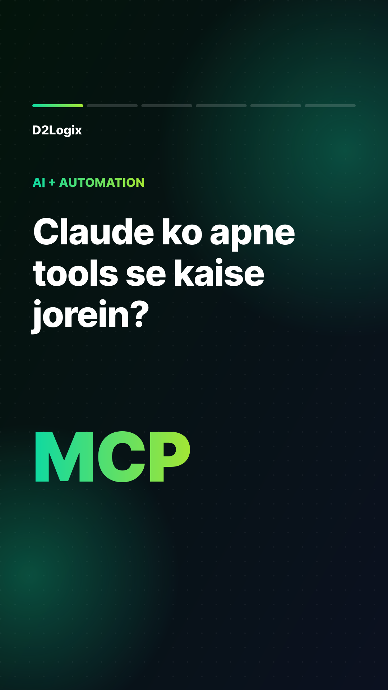
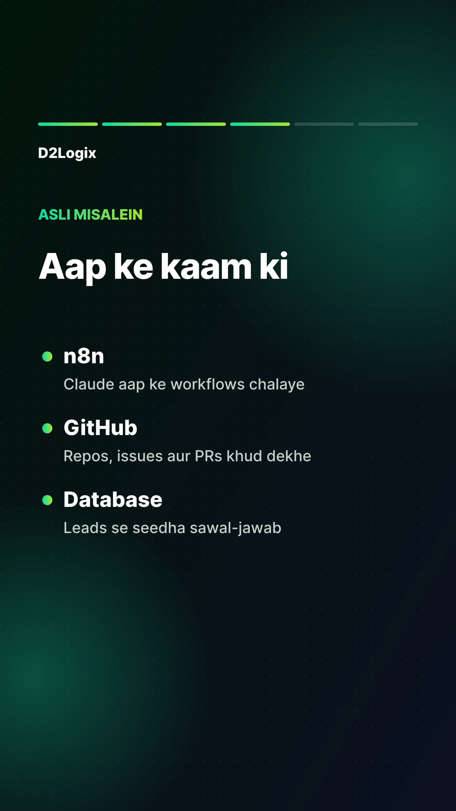

# Claude Reel Maker

> Topic in → **Claude writes the reel script** → **1080×1920 MP4** with animated slides, ready for Instagram Reels, TikTok and YouTube Shorts. No video editor needed.

   

| Title slide | Bullets slide |
|---|---|
|  |  |

## How it works

```
"What is MCP?" ──▶ draft.js ──▶ reel.json ──▶ render.js ──▶ slides (SVG → PNG via sharp) ──▶ ffmpeg ──▶ reel.mp4
                  Claude + JSON schema          (edit it if you like)          slow zoom + crossfades
```

- **Structured outputs:** Claude must return JSON matching `src/spec.js`, so the renderer never gets broken input.
- **Safe-area aware:** text stays between y 280–1460 so the Reels/TikTok UI never covers it.
- **Platform-ready MP4:** H.264 High, 30 fps, yuv420p, AAC track, `+faststart`.
- **Any language:** English, Urdu, Roman Urdu… (`--lang`).
- **Your brand:** name, initials, URL and colours in the spec.

## Quick start

```bash
git clone https://github.com/SameerD2logix/claude-reel-maker && cd claude-reel-maker
npm install                       # needs ffmpeg installed on the system
export ANTHROPIC_API_KEY=...

node src/draft.js "What is MCP?" --brand "D2Logix" --url d2logix.com --lang "Roman Urdu" > reel.json
node src/render.js reel.json out/
# ✓ 6 slides, 26.5 s → out/what-is-mcp.mp4
```

Try it without an API key: `npm run example` renders [`examples/what-is-mcp.json`](examples/what-is-mcp.json).

## Slide types

| type | Fields | Use for |
|---|---|---|
| `title` | kicker, title, highlight | the hook (first 2 seconds) |
| `big` | kicker, title, lines[] | one big idea |
| `bullets` | kicker, title, items[{label, detail}] (max 4) | lists, examples |
| `cta` | title, subtitle (+ brand.url button) | follow / visit |

## Tests

```bash
npm test
```
Covers spec validation, text wrapping/escaping, crossfade timing, the Claude request (fake client), and
a real MP4 render when ffmpeg is present.

## Author

**Sameer Hussain**, [D2Logix](https://d2logix.com). Used to make D2Logix's own explainer reels.
